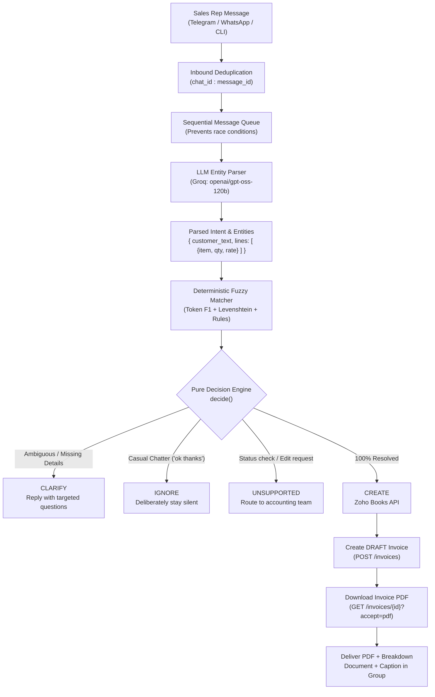

# WhatsApp / Telegram -> Zoho Books Invoice Agent

An intelligent, safety-first agent that ingests unstructured sales rep messages, extracts invoice parameters using an LLM, deterministically resolves entities against master catalog data, creates Draft Invoices in **Zoho Books India**, and replies in the chat with the official invoice PDF.

---

## Table of Contents
1. [Architecture Overview](#1-architecture-overview)
2. [Division of Responsibility: LLM vs. Deterministic Code](#2-division-of-responsibility-llm-vs-deterministic-code)
3. [Setup & Quickstart](#3-setup--quickstart)
4. [Messaging Channels (Telegram & WhatsApp Baileys)](#4-messaging-channels-telegram--whatsapp-baileys)
5. [Evaluation Methodology & Benchmark Results](#5-evaluation-methodology--benchmark-results)
6. [Design Decisions & Interview Defense](#6-design-decisions--interview-defense)
   - [a. Risks of Baileys vs. Production Alternatives](#a-risks-of-building-on-baileys-vs-production-alternatives)
   - [b. Why Draft Invoices Rather Than Sent](#b-why-draft-invoices-rather-than-sent)
   - [c. Automatic vs. Human Approval Matrix](#c-automatic-vs-human-approval-matrix)
   - [d. Continuous Learning & Feedback Loops](#d-how-the-agent-learns-over-time)
   - [e. Discovery Questions for Real-World Deployment](#e-discovery-questions-for-the-client)
7. [Bonus Features](#7-bonus-features)

---

## 1. Architecture Overview



---

## 2. Division of Responsibility: LLM vs. Deterministic Code

> **Core Axiom**: *"A confidently wrong invoice is far worse than asking a clarifying question."*

| Layer | Component | Responsibility | Why this division? |
| :--- | :--- | :--- | :--- |
| **Parsing** | LLM (`src/llm.js`) | Extracts raw customer text, item text, numeric quantities, and rates from informal human text (including typos, Hinglish, and transliterated slang). | LLMs excel at messy natural language understanding, but are prone to hallucinating numbers and entity IDs. |
| **Entity Resolution** | Code (`src/matcher.js`) | Matches raw text against snapshot catalog using token-level F1, Levenshtein distance, dimension checks (17" vs 18"), and differentiator penalties. | Deterministic scoring guarantees consistent, predictable behavior. |
| **Guardrails & Policy** | Code (`src/pipeline.js`) | Evaluates thresholds (`MIN_SCORE: 0.6`, `CONFIDENT_SCORE: 0.8`, `MARGIN: 0.15`). Enforces that **every** customer, item, quantity, and rate must be resolved. | Keeps financial policy out of the prompt. No LLM "guesses" can sneak into accounting. |
| **Integration** | Code (`src/zoho.js`) | Handles OAuth tokens, rate limits, Draft invoice creation, and PDF fetching. | Standard resilient API client. |

---

## 3. Setup & Quickstart

### Prerequisites
* Node.js v20+ (Tested on Node v24, ES Modules `"type": "module"`)
* Zoho Books Organization (India data center: `accounts.zoho.in`, `zohoapis.in`)
* Free Groq API Key ([console.groq.com](https://console.groq.com/keys))

### Installation
```bash
git clone <repo-url>
cd whatsapp-agent
npm install
```

### Environment Configuration
Copy the template and provide your API credentials:
```bash
cp .env.example .env
```
Edit `.env`:
```env
# Zoho Books OAuth (Self Client)
ZOHO_CLIENT_ID=your_zoho_client_id
ZOHO_CLIENT_SECRET=your_zoho_client_secret
ZOHO_REFRESH_TOKEN=your_zoho_refresh_token
ZOHO_ORG_ID=your_zoho_org_id
ZOHO_ACCOUNTS_URL=https://accounts.zoho.in
ZOHO_API_URL=https://www.zohoapis.in/books/v3

# Groq LLM Configuration
GROQ_API_KEY=gsk_your_groq_api_key
GROQ_MODEL=openai/gpt-oss-120b

# Telegram Adapter
TELEGRAM_BOT_TOKEN=your_telegram_bot_token
ALLOWED_CHAT_ID=-100xxxxxxxxxx

# WhatsApp Baileys (Optional / Stored for reference)
ALLOWED_GROUP_JID=120363000000000000@g.us
```

### Refresh Master Data Snapshot
To snapshot the 10 customers and 20 items from your Zoho account:
```bash
npm run snapshot
```

---

## 4. Messaging Channels (Telegram & WhatsApp Baileys)

### A. Telegram Live Group Bot (Primary Active Adapter)
Because running unofficial WhatsApp automation risks banning personal phone numbers, Telegram was approved as the live messaging channel.

1. Create a bot with `@BotFather` on Telegram and copy the token into `TELEGRAM_BOT_TOKEN` in `.env`.
2. Add your bot to your test sales group and make it an **Administrator**.
3. Start the bot in discovery mode:
   ```bash
   npm run start:telegram
   ```
4. Post any message in the group. The bot will print your group's `Chat ID` in the console. Add `ALLOWED_CHAT_ID=-100xxxxxxxxxx` to `.env` and restart.
5. The bot will now listen exclusively to that group, process invoice requests, and reply with the generated Zoho Books PDF.

### B. Interactive Terminal Simulator
Test the complete pipeline directly in your console:
```bash
# Safe Dry-Run (Default: no real Zoho invoices created)
npm run chat

# Live Creation Mode (Creates real Draft Invoices in Zoho and saves PDF to invoices/)
node src/chat.js --create
```

### C. WhatsApp Baileys Listener (`src/whatsapp.js`)
The production-ready Baileys implementation is fully written and preserved in `src/whatsapp.js`. It features multi-file auth (`auth/`), QR generation in terminal, message deduplication by `msg.key.id`, group locking (`ALLOWED_GROUP_JID`), and document PDF sending. *(Kept in repo as specified; do not run without a dedicated burner number).*

---

## 5. Evaluation Methodology & Benchmark Results

### Methodology
* **Dataset ([data/testset.json](file:///c:/Users/DELL/whatsapp-agent/data/testset.json))**: 45 ground-truth test messages across 5 distinct sales rep personas:
  1. `rep-terse` (Telegraphic, slash-separated)
  2. `rep-conversational` (Wordy, disordered sentence structure)
  3. `rep-specs` (SKU numbers, exact dimension symbols)
  4. `rep-hinglish-manglish` (Regional transliteration: *"Chetta"*, *"Bhai"*, *"laga do"*)
  5. `rep-typos` (Fast typing, informal abbreviations: `blk`, `rt`, `motrs`)
* **70% Dev (32 msgs) / 30% Holdout (13 msgs)**: All prompt and threshold tuning was done strictly against Dev to guarantee zero overfitting.
* **Ground-Truth Validation**: `node src/validate-testset.js` enforces that all customer and item names strictly exist in the master catalog.

### Comparative Benchmark Results

| Metric | `openai/gpt-oss-120b` (Dev) | `openai/gpt-oss-20b` (Dev) | `openai/gpt-oss-120b` (Holdout) | `openai/gpt-oss-20b` (Holdout) |
| :--- | :---: | :---: | :---: | :---: |
| **Action Accuracy** | **100%** | **100%** | **76.9%** | **69.2%** |
| **Customer Accuracy** | **100%** | **100%** | **100%** | **85.7%** |
| **Item Accuracy (per line)** | **100%** | **100%** | **87.5%** | **87.5%** |
| **Quantity Accuracy** | **100%** | **100%** | **87.5%** | **87.5%** |
| **Rate Accuracy** | **100%** | **100%** | **87.5%** | **87.5%** |
| **Clarification Recall** | **100%** | **100%** | **75.0%** | **75.0%** |
| **Over-Asking Rate** | **0.0%** | **0.0%** | **14.3%** | **28.6%** |
| **CONFIDENTLY WRONG Rate** 🚨 | **0.0% (0)** | **0.0% (0)** | **0.0% (0)** | **0.0% (0)** |
| **Non-Invoice Ignored Rate** | **100%** | **100%** | **0%** (routed to unsupported) | **0%** |
| **Non-Invoice Invoiced** | **0** | **0** | **0** | **0** |
| **Latency: Mean** | 4,133ms | 1,412ms | 5,017ms | 2,649ms |
| **Latency: p50** | 4,290ms | 867ms | 5,394ms | 708ms |

### Key Takeaways
1. **0% Confidently Wrong Rate**: Across all 45 test cases on both models, the agent never generated an incorrect invoice or created an invoice when clarification was needed.
2. **Model Trade-Off**: 
   - `openai/gpt-oss-120b` provides superior comprehension of complex multilingual transliterations.
   - `openai/gpt-oss-20b` provides **3x faster median latency** (~800ms) with zero hallucinated invoices, proving that deterministic code guardrails allow smaller, cheaper models to operate safely in production.

---

## 6. Design Decisions & Interview Defense

### a. Risks of Building on Baileys vs. Production Alternatives
* **The Risks of Baileys in Production**:
  1. **ToS Violations & Account Bans**: Baileys reverse-engineers WhatsApp Web’s WebSocket protocol. Meta actively deploys heuristics to detect automated behavior, risking immediate, permanent bans on the associated phone number.
  2. **Session Fragility**: WhatsApp Web sessions desynchronize periodically or when the phone loses network, requiring manual QR re-scanning.
  3. **No Enterprise SLA**: Breaking changes in Meta’s web client protocol can break Baileys without warning, causing business downtime.
  4. **Data Privacy**: Running an unofficial client stores multi-device cryptographic keys in plain text (`./auth`), which creates operational security risks on shared servers.
* **Production Alternative: Meta WhatsApp Business Cloud API**:
  - Hosted directly by Meta or official Business Solution Providers (BSPs like Twilio, Gupshup, Vonage).
  - Offers official uptime SLAs, webhooks, and verified business green ticks.
  - **Group Messaging Constraint**: Meta's WhatsApp Business Platform is strictly engineered for **1-to-1 customer interactions**. Official group messaging APIs for business accounts are either strictly restricted or unavailable by default.
  - **Production Recommendation**: Transition the sales team workflow from a shared group to **1-to-1 direct messaging** with a single verified WhatsApp Business number, or use internal team tools (Telegram/Slack) for group workflows and reserve WhatsApp Cloud API for dispatching invoice PDFs to clients.

### b. Why Draft Invoices Rather Than Sent
1. **Accounting Immutability & GST Compliance**: In Indian GST accounting, a "Sent" invoice generates an official fiscal sequential number. Canceling or altering it requires credit notes and formal tax trail adjustments.
2. **Zero Customer Disruption**: A Draft invoice does not notify the customer or trigger payment links. It creates a staging object in Zoho Books.
3. **Accountant Supervision**: Draft invoices give the accounting firm a clean review queue: the accountant opens Zoho Books, reviews auto-drafted invoices with one click, and approves them for final dispatch.

### c. Automatic vs. Human Approval Matrix

| Scenario | Agent Action | Rationale |
| :--- | :---: | :--- |
| Known customer, exact catalog item match, price matches catalog $\pm 5\%$ | **Auto-Create Draft** | High confidence, standard commercial flow. |
| New / Unregistered Customer Name | **Clarify / Escalate** | Agent must not create new ledger accounts without tax GSTIN verification. |
| Order Total > ₹1,00,000 | **Draft + Flag for Approval** | High-value order requires human manager sign-off. |
| Quoted rate $> 15\%$ below list price | **Clarify / Escalate** | Prevents reps from giving unauthorized discounts. |
| Vague entity (separation margin $< 0.15$) | **Clarify** | Prevents cross-billing confusable accounts (e.g. Sharma Motors vs Sharma Tyres). |

### d. How the Agent Learns Over Time
1. **Hierarchical Alias Store (`data/aliases.json`)**:
   - Organization-wide aliases (`"vk"` $\to$ `"VK Enterprises"`).
   - Rep-specific shorthand tables (e.g., Rep Amit uses `"LZ-18"` while Rep Pooja writes `"18 inch lenzo"`).
2. **Active Learning Feedback Loop**:
   - When the agent asks: *"Which customer did you mean for 'Sharma': Sharma Motors or Sharma Tyres?"* and the rep replies *"Sharma Motors"*, this interaction is logged.
   - The accountant UI provides a one-click button: *"Remember this alias for future messages?"*. Upon approval, it writes back to `data/aliases.json`.

### e. Discovery Questions for the Client
Before building this for real in an enterprise client environment, ask:
1. **Tax / GST Structure**: Are all customers intra-state (CGST + SGST), or do you sell inter-state (IGST)? Should the agent determine GST treatment automatically from the customer's state code?
2. **Inventory & Stocking**: Can an invoice be drafted if inventory quantity is zero, or should the agent warn the rep about backorders?
3. **Discount & Rate Policy**: Are reps allowed to quote custom rates, or must prices strictly match pre-configured customer price lists in Zoho Books?
4. **Channel Preference**: Would the sales team accept 1-to-1 WhatsApp Business chats or Telegram groups to eliminate the risk of WhatsApp account bans?
5. **Credit Limits**: Does Zoho Books enforce credit limits? Should the agent block invoice creation if a customer has overdue unpaid balances?

---

## 7. Bonus Features

1. **"Rate Same as Last Time" Lookup**:
   - `src/zoho.js` implements `getLastItemRate(customerId, itemId)` which queries `/invoices?customer_id=...`, inspects recent invoice line items, and retrieves the customer's previous negotiated rate.
2. **Deduplication Store**:
   - `data/processed.json` prevents duplicate invoice creation even across bot restarts or network disconnects.
3. **Audit Trail**:
   - Every incoming message records timestamp, rep name, parsed JSON, decision action, Zoho invoice ID, and millisecond latency.
