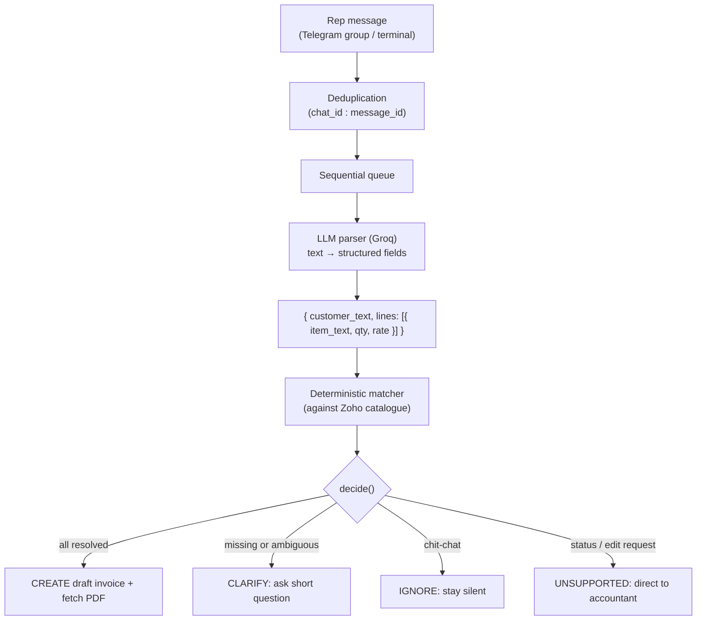

# Chat → Zoho Books Invoice Agent

A small bot that takes messy sales rep messages from a group chat, extracts the customer and order details, creates a draft invoice in Zoho Books, and sends back the invoice PDF. If anything is unclear or missing, it asks a short clarification question rather than guessing.

For example, when a rep sends:
```
VK red lenzo alloy 18 inch x 4 rate 5200
```
the bot replies:
```
Invoice INV-000123 created for VK Enterprises (draft)
   4 × Alloy Wheel 18" Lenzo - Red @ ₹5,200 = ₹20,800 (+GST)
   [invoice PDF]
```

If the rep sends something vague like `VK red wheel 4`, it won't pick an item on its own—it asks which wheel they meant.

---

> **Channel note:** The original brief requested WhatsApp via Baileys. I implemented and demoed this using Telegram instead. The reasoning is explained in [Why Telegram instead of WhatsApp](#why-telegram-instead-of-whatsapp).
>
> Demo video (2–4 min): _add link here_

---

## Contents

- [How it works](#how-it-works)
- [Why Telegram instead of WhatsApp](#why-telegram-instead-of-whatsapp)
- [Setup](#setup)
- [Running it](#running-it)
- [Master data in Zoho](#master-data-in-zoho)
- [Evaluation](#evaluation)
- [Design decisions](#design-decisions)
- [Onboarding a new client](#onboarding-a-new-client)
- [Limitations and future improvements](#limitations-and-future-improvements)

---

## How it works



### Architecture and division of responsibility

**The LLM extracts information. Code makes the decisions.**

| Responsibility | Handled by | Rationale |
|:---|:---|:---|
| Extracting raw text fields (customer name, items, quantities, rates) | LLM (`src/llm.js`) | LLMs handle unstructured text, varied phrasing, and typos well |
| Matching extracted strings to Zoho records | Deterministic code (`src/matcher.js`) | Scoring is predictable, testable, and prevents hallucinated IDs |
| Deciding whether to create, clarify, or ignore | Rule engine (`src/pipeline.js`, `decide()`) | Financial transactions shouldn't depend on prompt variations |
| Zoho authentication, invoice drafting, PDF export | API layer (`src/zoho.js`) | Standard API calls with token caching and retries |

The LLM is never asked to select a catalogue item or decide if an invoice should be raised. It simply parses what the rep wrote into structured JSON. All downstream matching and validation logic runs in standard code, making the behaviour easy to unit-test and debug.

### How matching works

For each customer or item text in a message, the matcher scores all records in the catalogue using token overlap and Levenshtein similarity, following this order:

1. **Known aliases:** Predefined shorthand (e.g. `vk` → `VK Enterprises`) matches immediately.
2. **Exact token match:** Matches where all query tokens align with a single record.
3. **Substring containment:** If the text unambiguously matches within only one record.
4. **Confident match:** Score ≥ 0.8 with at least a 0.15 margin over the runner-up.
5. **Ambiguous match:** Score ≥ 0.6 or multiple close matches trigger a clarification question.
6. **Vague description:** Broad terms matching several records (like "red wheel") trigger a "which one?" question.
7. **No match:** Handled as not found, asking the rep for details.

Numerical specifications (such as wheel sizes) are strictly protected: a query mentioning `18` will heavily penalise a 17" product, preventing unintended matches.

### Validation before creation

An invoice is drafted only when the customer, every line item, each quantity, and each rate are fully resolved. If any field is missing or ambiguous, the bot asks for clarification instead.

---

## Why Telegram instead of WhatsApp

The assignment suggested WhatsApp with Baileys using a spare number. I chose Telegram instead for practical reasons:

- **No spare phone number:** Baileys requires scanning a QR code with an active WhatsApp account on a physical device. I did not have a secondary SIM or spare phone.
- **Risk to personal number:** Baileys reverse-engineers WhatsApp's private protocol. Using automated bots on personal numbers violates WhatsApp terms and frequently leads to bans.
- **Virtual numbers are unreliable:** Online disposable number services often fail WhatsApp OTP verification or expire quickly, making them unviable for reliable testing and demos.

Telegram provided an official, reliable Bot API with native group support and zero risk of account suspension, allowing the full multi-user sales rep flow to be demonstrated cleanly.

Because the messaging layer is decoupled from the core logic, switching channels requires minimal effort: the parser, matcher, decision engine, and Zoho integration function identically regardless of the message source.

A reference implementation using Baileys is included in `src/whatsapp.js` following standard library conventions, though it was not run against live accounts.

### Production risks of Baileys

For production deployments, using Baileys carries notable trade-offs:

1. **Account bans:** Unofficial clients risk permanent phone number blacklisting by Meta without warning.
2. **Protocol instability:** Internal WhatsApp Web protocol updates can disrupt the connection until open-source maintainers release patches.
3. **Session desynchronisation:** Multi-device session states can desync on network interruptions, requiring manual QR rescanning.
4. **Plaintext credentials:** Session keys are stored locally on disk, requiring strict server-level security.

### Production alternative: WhatsApp Business Cloud API

The enterprise path is Meta's official WhatsApp Business Platform (Cloud API), accessed directly or through providers like Twilio or Gupshup:
- Provides official SLAs, webhooks, and verified business identities.
- *Group messaging limitation:* Meta's Cloud API focuses on 1-on-1 business messaging; group APIs are restricted to specific tiers and have participant limits.
- In a production setup, sales reps would typically message a dedicated business number 1-on-1, or use internal team tools (Slack/Telegram) for groups, while using WhatsApp Cloud API to send customer-facing invoices.

---

## Setup

Requires Node.js 20 or newer, a Zoho Books organisation (India DC), a free Groq API key, and a Telegram bot token.

```bash
git clone https://github.com/arjunvkaimal/zoho-invoice-agent.git
cd zoho-invoice-agent
npm install
cp .env.example .env
```

Configure `.env`:

```env
ZOHO_CLIENT_ID=
ZOHO_CLIENT_SECRET=
ZOHO_REFRESH_TOKEN=
ZOHO_ORG_ID=
ZOHO_ACCOUNTS_URL=https://accounts.zoho.in
ZOHO_API_URL=https://www.zohoapis.in/books/v3
GROQ_API_KEY=
GROQ_MODEL=openai/gpt-oss-120b
TELEGRAM_BOT_TOKEN=
ALLOWED_CHAT_ID=
```

### Zoho Books setup

1. Create a Zoho Books trial organisation at `zoho.in/books` and find your Organization ID under Settings → Organization Profile.
2. In the Zoho API Console (`api-console.zoho.in`), generate a Self Client code with these scopes:
   ```
   ZohoBooks.contacts.ALL,ZohoBooks.invoices.ALL,ZohoBooks.settings.ALL,ZohoBooks.items.ALL
   ```
3. Exchange the temporary code for a refresh token: `node get-token.js <code>`.
4. Add credentials to `.env`.
5. Verify the connection with `node test-zoho.js`.
6. Seed the sample catalogue if using a fresh trial org: `node src/seed.js` (use `--dry` to preview).

### Telegram bot setup

1. Message `@BotFather` on Telegram, create a bot via `/newbot`, and paste the token into `.env`.
2. Run `/setprivacy` in BotFather, select your bot, and set it to **Disable** (required for the bot to read messages in group chats).
3. Create a Telegram group and invite the bot.
4. Run `npm run start:telegram` and send a test message. Note the logged Chat ID, set `ALLOWED_CHAT_ID` in `.env`, and restart.

---

## Running it

| Task | Command |
|:---|:---|
| Telegram bot + live web UI log | `npm run start:telegram` (dashboard at `http://localhost:3000`) |
| Standalone web UI log viewer | `npm run dashboard` |
| Terminal simulator (dry-run mode) | `npm run chat` |
| Terminal simulator (creates real Zoho drafts) | `node src/chat.js --create` |
| Run evaluation benchmark | `npm run eval` |
| Generate evaluation markdown report | `npm run report` |
| Seed demo master data into Zoho | `node src/seed.js` |
| Validate test set against catalogue | `node src/validate-testset.js` |
| Refresh offline catalogue snapshot | `npm run snapshot` |

---

## Master data in Zoho

`node src/seed.js` populates sample customers and products for testing in a fresh organisation.

<details>
<summary>Ten customers</summary>

| Name |
|:---|
| City Wheel Hub |
| Gupta Auto |
| Gupta Auto Spares |
| Joseph & Sons |
| Kerala Tyre Mart |
| Mohan Auto Traders |
| Rajan Wheels |
| Sharma Motors |
| Sharma Tyres |
| VK Enterprises |

</details>

<details>
<summary>Twenty items</summary>

Tyres and wheel accessories with GST at 28%:

| Name | Rate (₹) |
|:---|---:|
| Alloy Wheel 16" Lenzo - Black | 4,400 |
| Alloy Wheel 17" Lenzo - Black | 4,800 |
| Alloy Wheel 17" Lenzo - Red | 4,900 |
| Alloy Wheel 17" Lenzo - Silver | 4,850 |
| Alloy Wheel 17" Vossen - Black | 6,200 |
| Alloy Wheel 17" Vossen - Gunmetal | 6,300 |
| Alloy Wheel 18" Lenzo - Black | 5,300 |
| Alloy Wheel 18" Lenzo - Red | 5,400 |
| Alloy Wheel 18" Lenzo - Silver | 5,350 |
| Alloy Wheel 18" Lenzo Sport - Red | 5,600 |
| Alloy Wheel 18" Vossen - Black | 6,900 |
| Alloy Wheel 18" Vossen - Gunmetal | 7,000 |
| Steel Wheel 15" Standard - Black | 1,950 |
| Steel Wheel 15" Standard - Silver | 1,900 |
| Tyre 205/55R16 | 4,200 |
| Tyre 215/55R17 | 4,900 |
| Wheel Cap Lenzo - Black | 250 |
| Wheel Cap Lenzo - Red | 250 |
| Wheel Nut Set Black | 480 |
| Wheel Nut Set Chrome | 450 |

</details>

---

## Evaluation

### Primary metric: Confidently Wrong Rate

In invoicing workflows, incorrect invoices cause accounting corrections and billing disputes, whereas asking a quick clarification question only takes a few seconds. The benchmark focuses on the **Confidently Wrong Rate**—instances where the system creates an invoice with incorrect details or creates one when it should have asked for clarification.

Target: **0%**. Result: **0% across all 45 test cases on both evaluated models**.

### Dataset

Located in `data/testset.json` with 45 ground-truth test cases across five sales rep styles, split 70% Dev (32) and 30% Holdout (13):

| Persona | Characteristics |
|:---|:---|
| `rep-terse` | Short, slash-delimited notes |
| `rep-conversational` | Wordy messages with scattered details |
| `rep-specs` | Exact dimensions and SKU references |
| `rep-hinglish-manglish` | Regional phrasing ("Chetta", "Bhai", "laga do") |
| `rep-typos` | Shorthand and typing errors (`blk`, `rt`, `motrs`) |

All prompt adjustments and threshold choices were developed exclusively using the Dev split. The Holdout split was evaluated afterward without subsequent tuning.

### Benchmark results

| Metric | `gpt-oss-120b` (Dev) | `gpt-oss-20b` (Dev) | `gpt-oss-120b` (Holdout) | `gpt-oss-20b` (Holdout) |
|:---|:---:|:---:|:---:|:---:|
| Action accuracy | 100% | 100% | 76.9% | 69.2% |
| Customer accuracy | 100% | 100% | 100% | 85.7% |
| Item accuracy (per line) | 100% | 100% | 87.5% | 87.5% |
| Quantity accuracy | 100% | 100% | 87.5% | 87.5% |
| Rate accuracy | 100% | 100% | 87.5% | 87.5% |
| Clarification recall | 100% | 100% | 75.0% | 75.0% |
| Over-asking rate | 0% | 0% | 14.3% | 28.6% |
| **Confidently Wrong Rate** | **0%** | **0%** | **0%** | **0%** |
| Non-invoice ignored | 100% | 100% | 0% † | 0% † |
| Non-invoice invoiced | 0 | 0 | 0 | 0 |
| Latency mean | 4,133 ms | 1,412 ms | 5,017 ms | 2,649 ms |
| Latency p50 | 4,290 ms | 867 ms | 5,394 ms | 708 ms |

† The Holdout non-invoice cases were status queries. The bot classified them as `unsupported` (answering "please check with the accountant") rather than staying silent. While functionally appropriate, it differed from the dataset's `ignore` label.

### Dev vs. Holdout observations

Accuracy dropped from 100% on Dev to ~77% on Holdout due to three edge cases:
1. The status query classification noted above.
2. Malayalam transliterations (`ayakkanam`) where both models preferred to clarify rather than assume the product.
3. Heavily abbreviated customer names (`rajan whls`), which the smaller model asked to confirm while the larger model resolved directly.

### Model comparison

`gpt-oss-120b` offers stronger comprehension on informal and transliterated input. `gpt-oss-20b` runs about 3× faster (median latency ~870 ms vs ~4,300 ms). Because both rely on deterministic code filters, neither model produced false invoices.

---

## Design decisions

### Why draft invoices instead of sent invoices

Under Indian GST rules, generating a "Sent" invoice issues a sequential fiscal invoice number. Correcting or voiding it requires formal credit notes and audit entries. Creating invoices in "Draft" status allows the accounts team to review and approve them before formal issuance, avoiding unwanted tax adjustments or customer alerts.

### System response rules

| Situation | Response |
|:---|:---|
| Known customer, unambiguous item, valid quantity & rate | Create draft invoice in Zoho |
| Customer not found in records | Ask for customer name |
| Ambiguous item match (e.g. "red wheel") | Ask rep which item was intended |
| Missing or zero rate | Ask for rate |
| Rate deviates significantly from list price | _(Planned improvement)_ |
| Status queries or edit requests | Reply advising to contact accountant |
| Non-order conversation | Remain silent |

### Aliases and shorthand

`data/aliases.json` handles common abbreviations (e.g. `"vk"` → `"VK Enterprises"`). Aliases are checked prior to fuzzy matching and can be updated without changing application code.

### Message deduplication

Processed message IDs are tracked in `data/processed.json` (git-ignored) using `<chat_id>:<message_id>`. This prevents duplicate invoice generation if network drops cause message replays.

### File structure

```
src/
  llm.js          — Groq client with JSON schema enforcement and retries
  matcher.js      — Deterministic fuzzy matcher
  pipeline.js     — Decision logic, live catalogue caching and refresh
  zoho.js         — Zoho Books API client, token refresh, and PDF download
  telegram.js     — Telegram group bot adapter with sequential queue
  dashboard.js    — Minimal real-time web UI log viewer (SSE)
  logger.js       — In-memory message and transaction event store
  chat.js         — Terminal simulator with dry-run and live creation modes
  whatsapp.js     — Baileys listener reference implementation
  seed.js         — Seeds sample master data in Zoho Books
  eval.js         — Evaluation runner
  report.js       — Generates markdown summary of test results
  snapshot.js     — Updates offline catalogue snapshot for testing
data/
  aliases.json        — Abbreviation to full entity mappings
  catalog-snapshot.json — Static snapshot for offline eval consistency
  testset.json        — 45 benchmark test messages
  master-data.json    — Seed definitions
results/
  REPORT.md       — Detailed evaluation report
  CHANGELOG.md    — Run history log
```

---

## Onboarding a new client

Today, this prototype is configured for a single wheel and tyre trader through a single `.env` file. Onboarding a new client requires moving from this single-tenant setup to a multi-client architecture:

1. **Per-client configuration & credentials:** Instead of one `.env` with a Self Client, each client needs their own Zoho OAuth authorisation, organisation ID, data centre domain (`.in`, `.com`, `.eu`), chat group ID, tax rules, and secrets stored in a secure vault.
2. **Catalogue loading & scaling:** The live catalogue fetch (`src/pipeline.js`) is not tied to this client's data, though it has only been run against one organisation; `master-data.json` and `catalog-snapshot.json` were created purely for my offline evaluation. For production, catalogues must be cached per tenant. Because limits apply per organisation and per plan; check Zoho's current limits for the client's plan, clients with thousands of items will need an indexed search (e.g. SQLite FTS or BM25) before fuzzy matching.
3. **Generalising client-specific assumptions (Future Work):**
   - *LLM Prompt:* Currently includes wheel-trading examples and auto-parts context in `src/llm.js`. Generalise by injecting a short business description, and by building few-shot examples from the client's past chat messages paired with the invoices the accountant created.
   - *Stop-words, token aliases & units:* Today, `src/matcher.js` handles only inches (`inch`, `in`, `-inch`, `"`, `'`) with no other units handled; hardcodes token replacements for four words (`blk` → `black`, `slv`/`slvr` → `silver`, `whls` → `wheels`, `motrs` → `motors`); and uses a single hardcoded stop-word set of seven words combining items and customers (`wheel`, `alloy`, `standard`, `set`, `enterprises`, `hub`, `mart`). Generalise by moving token aliases and units into per-client configuration, and by separating and tuning item and customer stop-words for the client's catalogue.
   - *Thresholds:* The 0.60/0.80 scoring thresholds were tuned on my 45 wheel messages; they should be re-calibrated on the new client's data.
4. **Cold start & aliases:** New clients start with an empty alias dictionary. Bootstrap initial customer-item pairings and typical pricing from the client's past Zoho invoice history. Shorthand used by sales reps should be learned incrementally with accountant approval.
5. **Client-specific evaluation:** Before going live, collect 50+ historical chat messages from the client's sales team paired with actual accountant-approved invoices. Split into dev and holdout sets, running the evaluation harness and reporting every confidently-wrong case, aiming to keep them at zero, together with the sample size so the result is not over-read.
6. **Staged rollout:** Deploy in shadow mode first (the bot evaluates orders and drafts in silence for accountant review). Move next to draft-only replies with PDF review in group chat, before enabling deeper automation.
7. **Accounting variations:** Accommodate differences across clients: Indian GST vs foreign VAT or US sales tax, place-of-supply resolution, line-item discounts, multi-currency, custom fields (like pharmaceutical batch/expiry numbers), and credit limits.
8. **Tenant isolation:** Enforce strict per-client isolation across message queues, catalogue caches, alias files, and audit logs.

Only the wheel catalogue has been tested; behaviour on other businesses is untested.

---

## Limitations and future improvements

- **Single-turn dialogue:** The bot currently evaluates each message independently. If it asks a clarifying question, the user's follow-up is parsed without prior message context. Storing conversational state per group thread would improve follow-ups.
- **Price deviation warnings:** Currently, any positive rate is accepted. A sanity check flagging prices substantially below or above list price (e.g. accidental extra zeros) would provide an extra safeguard.
- **Multi-item partial clarifications:** If a multi-line order has one ambiguous item, the bot clarifies both. Enabling line-by-line state tracking would make multi-item corrections smoother.
- **Catalogue fallback behaviour:** The bot pulls the live catalogue from Zoho on startup and refreshes it every 30 minutes in memory. If Zoho is unreachable during startup, it falls back to the saved snapshot and logs a warning until the next sync.
- **Historical rate lookup:** `src/zoho.js` includes `getLastItemRate()` to retrieve a customer's previously invoiced rate when requested, though it requires existing invoice history for that customer and item.
- **WhatsApp via Baileys is reference-only:** `src/whatsapp.js` is provided for structural reference but has not been tested against live accounts.
