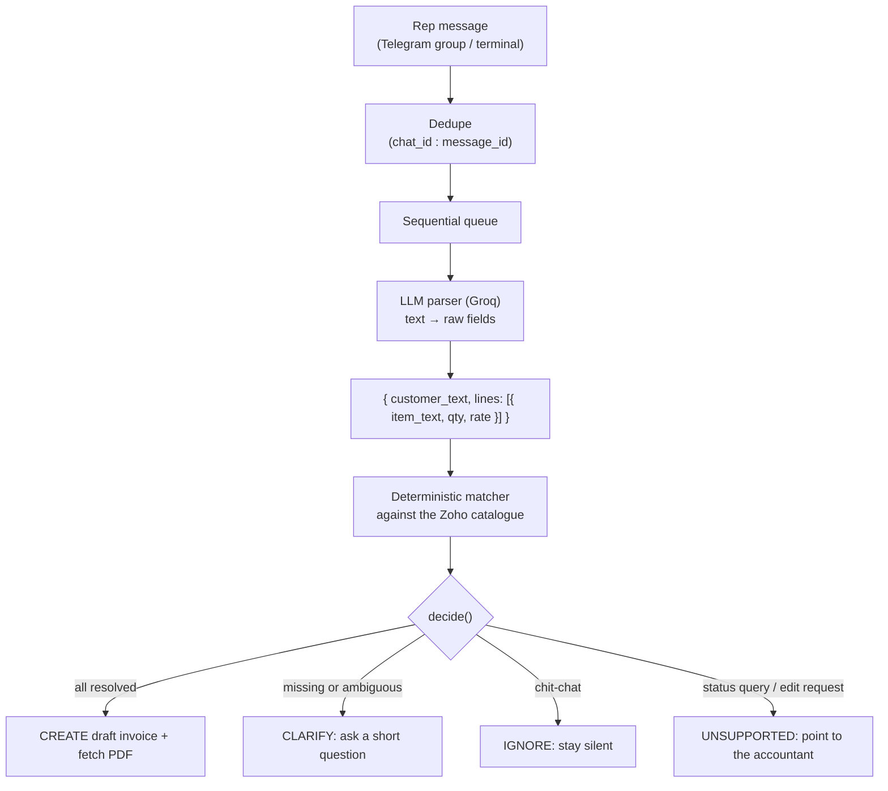

# Chat → Zoho Books Invoice Agent

A small agent that reads messy sales-rep messages in a group chat, works out who the customer is and what they're buying, creates a draft invoice in Zoho Books, and replies in the group with the invoice PDF. When it isn't sure, it asks a short question instead of guessing.

A rep writes this:
```
VK red lenzo alloy 18 inch x 4 rate 5200
```
and the agent replies:
```
✅ Invoice INV-000123 created for VK Enterprises (draft)
   4 × Alloy Wheel 18" Lenzo - Red @ ₹5,200 = ₹20,800 (+GST)
   [invoice PDF]
```

If the rep writes just `VK red wheel 4`, it doesn't pick a wheel for them. It asks which one.

---

> **A note on the channel.** The brief asked for WhatsApp via Baileys. I built and demoed this on Telegram instead, with the recruiter's approval. The reasons are in [Why Telegram and not WhatsApp](#why-telegram-and-not-whatsapp).
>
> Demo video (2–4 min): _add link here_

---

## Contents

- [How it works](#how-it-works)
- [Why Telegram and not WhatsApp](#why-telegram-and-not-whatsapp)
- [Setup](#setup)
- [Running it](#running-it)
- [Master data in Zoho](#master-data-in-zoho)
- [The evaluation](#the-evaluation)
- [Design decisions](#design-decisions)
- [Limitations and what I'd do next](#limitations-and-what-id-do-next)

---

## How it works



### The one rule that shapes everything

**The LLM reads. The code decides.**

| Part | Who does it | Why |
|:---|:---|:---|
| Turning text into raw fields (customer text, item text, quantity, rate) | LLM (`src/llm.js`) | Messy language, typos and word order are what LLMs are good at |
| Matching those strings to real Zoho customers and items | Code (`src/matcher.js`) | Scoring is repeatable and testable, and it never invents an ID |
| Act, ask, or ignore | Code (`src/pipeline.js`, `decide()`) | A money decision shouldn't depend on how a prompt happened to be phrased |
| Zoho auth, invoice creation, PDF download | Code (`src/zoho.js`) | Plain API plumbing with token refresh and retries |

The LLM is never asked to choose a catalogue item or to decide whether to create an invoice. It only copies what the rep typed into a structured shape. Everything after that is ordinary code, so I can unit-test it and explain exactly why it did what it did.

### How the matcher decides

For each customer or item string, the matcher scores every catalogue record (token overlap plus a small typo tolerance) and then applies rules in this order:

1. A learned alias (for example `vk` → `VK Enterprises`) wins immediately.
2. An exact token match, with nothing else equally exact, is accepted.
3. If the text is fully contained in only one record, it's accepted.
4. A clear winner (score ≥ 0.8 and ahead of the runner-up by ≥ 0.15) is accepted.
5. A plausible but unclear match (score ≥ 0.6) becomes a clarification question.
6. A vague query that fits several records (like "red wheel") becomes a "which one?" question.
7. Anything else is "not found".

Sizes are protected: a query that says `18` will never quietly match a 17" item, because a number that doesn't match halves the score.

### When it asks instead of acting

An invoice is created only if the customer, every item, every quantity and every rate are resolved. Otherwise it asks. It also asks when a rate is `0` or missing — an explicit rate-deviation check (e.g. flagging a rate more than 50% away from the list price) is a planned improvement not yet in the code.

---

## Why Telegram and not WhatsApp

The task asked for WhatsApp using Baileys, on a spare number. I didn't do that, and here is the honest reasoning.

- **I don't have a spare number.** Baileys needs a real WhatsApp account to scan a QR code with. I had no spare SIM or second phone.
- **I wasn't willing to link my personal number.** Baileys is an unofficial, reverse-engineered client. Using it goes against WhatsApp's terms and numbers can be banned. Losing my own number wasn't a risk worth taking for a prototype.
- **Temporary-number websites aren't a real fix.** They often fail WhatsApp's verification, and you lose the account when the rental ends, which is a bad foundation for a demo.


Telegram turned out to be a good stand-in. The Bot API is official and free, bots can live in real groups with several people, and there's no ban risk. That let me show the actual workflow (a group of reps and a bot) honestly.

Because the chat layer is deliberately thin (message text in, reply out), the channel is swappable. The matching, the decisions and the Zoho code don't know or care whether the message came from Telegram, a terminal or anything else.

An untested Baileys listener is kept in `src/whatsapp.js` for reference. I did not run it against a real WhatsApp account, so I can't vouch for it beyond the fact that it follows the library's documented pattern.

### Baileys in production: the risks

If a client really wanted WhatsApp groups handled through Baileys, I'd tell them:

1. **Terms of service and bans.** It's unofficial. Any number using it can be restricted or banned without warning, and the client loses their business number with it.
2. **No support or SLA.** A WhatsApp protocol change can break it overnight, and the fix depends on volunteer maintainers.
3. **Session fragility.** The linked-device session and its encryption state can desync, causing missed messages or forced QR re-scans.
4. **Credentials on disk.** The session folder gives full access to the account and is stored unencrypted, so it needs real protection on a server.
5. **Privacy and consent.** It reads a client's group chats through a linked session, which needs their explicit agreement.

### The production alternative

The official route is the WhatsApp Business Platform (Cloud API), directly from Meta or through a provider such as Twilio or Gupshup. It's supported, has webhooks, and carries no ban risk for compliant use.

Groups are the catch. At the time of writing, Meta's Groups API exists, but as I read the documentation it requires an Official Business Account, caps groups at 8 participants, allows only one Cloud API business per group, and isn't available on WhatsApp Business app numbers. Meta's rules and pricing change, so check their current pages before relying on any of this. For a real deployment I'd likely propose reps messaging a single business number one-to-one, or keeping group workflows on a tool like Telegram.

I didn't get as far as running the Cloud API myself, so everything in this section about it comes from reading documentation, not from hands-on testing.

---

## Setup

You'll need Node.js 20 or newer, a Zoho Books organisation (India data centre), a free Groq API key, and a Telegram bot token.

```bash
git clone https://github.com/arjunvkaimal/zoho-invoice-agent.git
cd zoho-invoice-agent
npm install
cp .env.example .env
```

Fill in `.env`. No real values are committed to this repo.

```env
ZOHO_CLIENT_ID=
ZOHO_CLIENT_SECRET=
ZOHO_REFRESH_TOKEN=
ZOHO_ORG_ID=
ZOHO_ACCOUNTS_URL=https://accounts.zoho.in
ZOHO_API_URL=https://www.zohoapis.in/books/v3
GROQ_API_KEY=
GROQ_MODEL=openai/gpt-oss-120b
TELEGRAM_BOT_TOKEN=
ALLOWED_CHAT_ID=
```

### Zoho Books

1. Create a Zoho Books trial org at zoho.in/books and note the Organization ID (Settings → Organization Profile).
2. In the Zoho API Console (`api-console.zoho.in`), create a Self Client and generate a code with these scopes, comma-separated with no spaces:
   ```
   ZohoBooks.contacts.ALL,ZohoBooks.invoices.ALL,ZohoBooks.settings.ALL,ZohoBooks.items.ALL
   ```
3. Exchange the code for a refresh token right away (it expires in minutes): `node get-token.js <code>`.
4. Put the client ID, client secret, refresh token and org ID in `.env`.
5. Check the connection: `node test-zoho.js` should print OK for the token, contacts and items.
6. Create the master data: `node src/seed.js` (use `--dry` first to see what it would do). It's safe to re-run.

### Telegram

1. Message `@BotFather`, send `/newbot`, and copy the token into `.env`.
2. Send `/setprivacy`, choose your bot, and pick **Disable**. Otherwise the bot only sees commands in groups, not normal messages. Do this before adding the bot to the group.
3. Create a group and add the bot and a teammate.
4. Start the bot with `npm run start:telegram` and post any message. The bot logs the group's chat ID. Put it in `ALLOWED_CHAT_ID` and restart.

### Catalogue snapshot

`npm run snapshot` saves the current customers and items to `data/catalog-snapshot.json`, so evaluations run offline and don't hit Zoho for every message.

---

## Running it

| What | Command |
|:---|:---|
| Telegram bot (live group) | `npm run start:telegram` |
| Terminal simulator, dry run (creates nothing) | `npm run chat` |
| Terminal simulator, creates real invoices | `node src/chat.js --create` |
| Run the evaluation | `npm run eval` |
| Generate the evaluation report | `npm run report` |
| Seed the Zoho catalogue | `node src/seed.js` |
| Validate the test set against the snapshot | `node src/validate-testset.js` |

---

## Master data in Zoho

`node src/seed.js` creates ten customers and twenty items in Zoho Books. Running it again is safe; it skips anything that already exists.

<details>
<summary>Ten customers</summary>

| Name | State |
|:---|:---|
| VK Enterprises | Kerala |
| Sharma Motors | Maharashtra |
| Sharma Tyres | Maharashtra |
| Rajan Wheels | Tamil Nadu |
| Kerala Tyre Mart | Kerala |
| Malabar Auto Parts | Kerala |
| Chennai Wheel House | Tamil Nadu |
| Bangalore Motors Hub | Karnataka |
| Hyderabad Tyre World | Telangana |
| Delhi Rim Centre | Delhi |

</details>

<details>
<summary>Twenty items</summary>

All items are tyre and wheel accessories with GST at 28%.

| Name | Rate (₹) |
|:---|---:|
| Tyre 195/65R15 | 3,800 |
| Tyre 205/55R16 | 4,200 |
| Tyre 215/55R17 | 4,900 |
| Tyre 225/45R18 | 5,600 |
| Alloy Wheel 15" Lenzo - Black | 3,500 |
| Alloy Wheel 15" Lenzo - Silver | 3,500 |
| Alloy Wheel 17" Lenzo - Red | 4,500 |
| Alloy Wheel 17" Vossen - Black | 4,800 |
| Alloy Wheel 18" Lenzo - Red | 5,200 |
| Alloy Wheel 18" Vossen - Black | 5,500 |
| Wheel Cap Lenzo - Red | 250 |
| Wheel Cap Vossen - Black | 280 |
| Wheel Cap OEM - Silver | 200 |
| Nitrogen Inflation (per tyre) | 50 |
| Wheel Balancing (per wheel) | 150 |
| Tyre Rotation (set of 4) | 400 |
| Tyre Puncture Repair | 120 |
| Valve Stem Set (4 pcs) | 80 |
| Wheel Alignment | 600 |
| Rim Cleaning & Polishing | 350 |

</details>

---

## The evaluation

### What was measured

An invoice agent has an asymmetric cost function: a wrong invoice is far more expensive than a clarification question. So the primary metric is the **Confidently Wrong Rate** — cases where the agent created an invoice with incorrect fields, or created one when it should have asked first.

Target: **0%**. Result: **0% on both models across all 45 test cases**.

### Dataset

`data/testset.json` — 45 messages, split 70/30 into Dev (32) and Holdout (13), across five rep personas:

| Persona | Style |
|:---|:---|
| `rep-terse` | Telegraphic, slash-separated |
| `rep-conversational` | Wordy, disordered sentence structure |
| `rep-specs` | SKU numbers, exact dimension symbols |
| `rep-hinglish-manglish` | Regional transliteration ("Chetta", "Bhai", "laga do") |
| `rep-typos` | Fast typing, informal abbreviations (`blk`, `rt`, `motrs`) |

All prompt and threshold tuning was done against Dev only. The Holdout split was run once, after tuning was complete.

### Results

| Metric | `gpt-oss-120b` Dev | `gpt-oss-20b` Dev | `gpt-oss-120b` Holdout | `gpt-oss-20b` Holdout |
|:---|:---:|:---:|:---:|:---:|
| Action accuracy | 100% | 100% | 76.9% | 69.2% |
| Customer accuracy | 100% | 100% | 100% | 85.7% |
| Item accuracy (per line) | 100% | 100% | 87.5% | 87.5% |
| Quantity accuracy | 100% | 100% | 87.5% | 87.5% |
| Rate accuracy | 100% | 100% | 87.5% | 87.5% |
| Clarification recall | 100% | 100% | 75.0% | 75.0% |
| Over-asking rate | 0% | 0% | 14.3% | 28.6% |
| **Confidently Wrong Rate** | **0%** | **0%** | **0%** | **0%** |
| Non-invoice ignored | 100% | 100% | 0% † | 0% † |
| Non-invoice invoiced | 0 | 0 | 0 | 0 |
| Latency mean | 4,133 ms | 1,412 ms | 5,017 ms | 2,649 ms |
| Latency p50 | 4,290 ms | 867 ms | 5,394 ms | 708 ms |

† The Holdout "ignore" cases were status queries. Both models routed them to `unsupported` (which replies "check with your accountant") instead of staying silent. That's a reasonable response — it just doesn't match the ground-truth label of `ignore`.

### Dev–Holdout gap

Action accuracy drops from 100% to ~77% on Holdout. Three causes account for nearly all of it:

1. **The status-query labelling issue** described above (1 case, both models).
2. **Malayalam transliteration** (`ayakkanam` for a tyre spec) — both models over-asked rather than extracted the item.
3. **Heavy typos in a customer name** (`rajan whls`) — the small model over-asked; the large model resolved it.

The gap is real. The agent is tuned on the Dev set, and Holdout shows where it still struggles.

### Model trade-off

`gpt-oss-120b` handles complex multilingual text better. `gpt-oss-20b` is roughly 3× faster at median latency (~870 ms vs ~4,300 ms) and cheaper. Both achieve 0% Confidently Wrong. Either is a safe choice; the larger model is worth it if the rep base uses a lot of regional transliteration.

> **Note on model names.** Groq's available models change. `openai/gpt-oss-120b` and `openai/gpt-oss-20b` were the models available on this account at eval time. If you see a 404 from Groq, check `groq.com/docs/models` for the current list and update `GROQ_MODEL` in `.env`.

---

## Design decisions

### Why draft invoices, not sent ones

In Indian GST accounting, a "Sent" invoice generates an official sequential fiscal number. Cancelling or correcting it requires credit notes and a formal tax trail. A Draft invoice creates a staging object in Zoho Books — the accountant can review it, correct it if needed, and approve it in one click. No customer is notified, no GST number is consumed.

### What's automatic and what isn't

| Scenario | Agent action |
|:---|:---|
| Known customer, unambiguous item, valid rate | Create draft invoice |
| Customer not found in Zoho | Ask |
| Item ambiguous (e.g. "red wheel" → 3 matches) | Ask which one |
| Rate is zero or missing | Ask |
| Rate deviates more than 50% from list price | _(planned — not yet implemented)_ |
| Status query or edit request | Reply "check with accountant" |
| Chit-chat, non-invoice message | Stay silent |

### Aliases

`data/aliases.json` maps abbreviations to full names. `"vk"` resolves to `"VK Enterprises"` before the fuzzy matcher even runs. Aliases can be added without touching the code or restarting the bot.

### Deduplication

Every processed message ID is written to `data/processed.json` (not committed). If the bot restarts mid-send or a message arrives twice, it won't create a duplicate invoice.

### File layout

```
src/
  llm.js          — Groq client, JSON mode, retry on bad JSON
  matcher.js      — deterministic fuzzy matcher
  pipeline.js     — decide(), processMessage(), createFromDecision()
  zoho.js         — Zoho Books API client (India DC), token refresh
  telegram.js     — grammY adapter, group filter, queue, routing
  chat.js         — terminal simulator (--create flag for live Zoho)
  whatsapp.js     — Baileys listener (written, untested, kept for reference)
  seed.js         — creates master data in Zoho Books
  eval.js         — evaluation harness
  report.js       — generates results/REPORT.md
  snapshot.js     — saves catalogue to data/catalog-snapshot.json
data/
  aliases.json        — abbreviation → full name mappings
  catalog-snapshot.json — offline catalogue snapshot for eval
  testset.json        — 45 ground-truth test messages
  master-data.json    — seed data definitions
results/
  REPORT.md       — latest evaluation report
  CHANGELOG.md    — per-run history
```

---

## Limitations and what I'd do next

**Single-turn only.** If the agent asks a question, the rep's answer is treated as a brand-new message. The agent doesn't remember what it asked. A conversation state store (keyed on chat ID) would fix this.

**Rate deviation check not implemented.** The code currently blocks only zero or missing rates. A check that flags rates more than 50% away from the list price — catching things like an accidental extra zero (53,000 instead of 5,300) — would be a useful safety addition.

**No multi-line clarification merge.** If two lines in one message both need clarification, the agent asks about both at once. If the rep answers one, the next message is still treated fresh.

**Catalogue is static.** The snapshot is taken once. If items or customers are added to Zoho Books, the bot needs a restart to pick them up. A periodic re-fetch (every hour, say) would keep it current.

**"Rate same as last time" is implemented but limited.** `src/zoho.js` has `getLastItemRate()` which queries the customer's invoice history. It works when the customer has a prior invoice for that item. If they don't, the agent falls back to asking for the rate.

**WhatsApp via Baileys is untested.** `src/whatsapp.js` exists and follows the library's documented pattern, but it has never been run against a real account. See [Why Telegram and not WhatsApp](#why-telegram-and-not-whatsapp).
